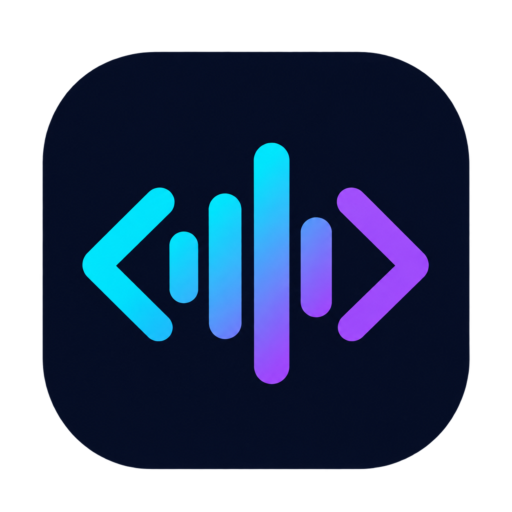
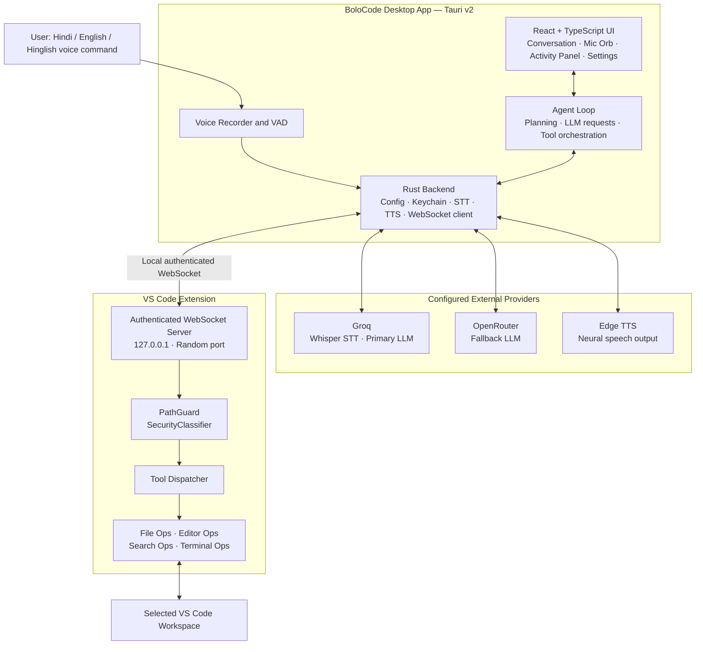
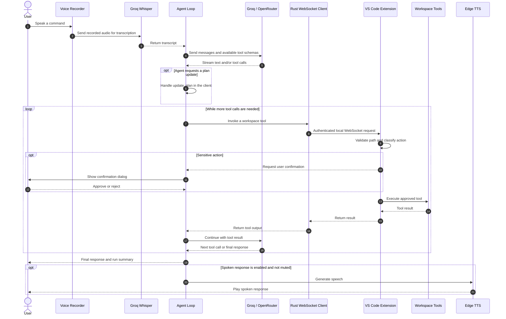

<div align="center">
  
</div>

<h1 align="center">BoloCode</h1>
<h3 align="center">Voice-First AI Coding Agent for VS Code</h3>

<p align="center">
  <strong>बोलो, और कोड हो जाए।</strong><br />
  <em>Speak, and let the code happen.</em>
</p>

<p align="center">
  <a href="LICENSE"></a>
  
  
  
</p>

<p align="center">
  <strong>Build, edit, search, and run code in your VS Code workspace using natural voice commands.</strong>
</p>

<p align="center">
  <a href="#features">Features</a> ·
  <a href="#architecture">Architecture</a> ·
  <a href="#getting-started">Getting Started</a> ·
  <a href="#how-it-works">How It Works</a> ·
  <a href="#configuration">Configuration</a> ·
  <a href="#security-and-privacy">Security</a> ·
  <a href="#development">Development</a> ·
  <a href="#roadmap">Roadmap</a>
</p>

---

## Table of Contents

- [What is BoloCode?](#what-is-bolocode)
- [Why BoloCode?](#why-bolocode)
- [Features](#features)
  - [Voice Interface](#1-voice-interface)
  - [AI Coding Agent](#2-ai-coding-agent)
  - [VS Code Workspace Tools](#3-vs-code-workspace-tools)
  - [Desktop Experience](#4-desktop-experience)
- [Architecture](#architecture)
  - [System Overview](#system-overview)
  - [Key Design Decisions](#key-design-decisions)
- [How It Works](#how-it-works)
  - [Request Lifecycle](#request-lifecycle)
  - [Agent Event System](#agent-event-system)
  - [Tool Activity Labels](#tool-activity-labels)
- [Getting Started](#getting-started)
  - [Prerequisites](#prerequisites)
  - [Get the Repository and Install the VS Code Extension](#step-1-get-the-repository-and-install-the-vs-code-extension)
  - [Build and Run the Desktop App](#step-2-build-and-run-the-desktop-app)
  - [First-Run Setup](#step-3-complete-the-first-run-setup)
- [Configuration](#configuration)
  - [Settings Reference](#settings-reference)
  - [Available TTS Voices](#available-tts-voices)
- [Security and Privacy](#security-and-privacy)
  - [Network Security](#network-security)
  - [Workspace File-System Protection](#workspace-file-system-protection)
  - [Confirmation for Sensitive Actions](#confirmation-for-sensitive-actions)
  - [API Key Storage](#api-key-storage)
  - [What Leaves Your Device?](#what-leaves-your-device)
- [Project Structure](#project-structure)
- [Development](#development)
  - [Run Tests](#run-tests)
  - [Explore the UI Gallery](#explore-the-ui-gallery)
  - [Build the VS Code Extension](#build-the-vs-code-extension)
  - [Build the Desktop App](#build-the-desktop-app)
- [Roadmap](#roadmap)
- [Technology Stack](#technology-stack)
- [Contributing](#contributing)
- [License](#license)

---

## What is BoloCode?

**BoloCode is a voice-first AI coding agent that connects a Tauri desktop application to your VS Code workspace.** It lets you describe development tasks in **Hindi, English, or Hinglish** and turns those instructions into concrete actions: creating files, editing code, searching a project, opening files, and running terminal commands.

The desktop app captures your voice and obtains a transcript. The agent sends the request to your configured language model, decides which workspace tools are needed, and asks the VS Code extension to execute those tools. You can follow the plan and tool activity in the app while the task runs.

For example, you can say:

> "Ek todo app banao React mein, with hooks and local storage."

BoloCode can plan the task, create the required project files, run commands such as `npm install` when needed, and report the outcome.

### Local-first, with a clear cloud boundary

The desktop application, wake-word detection, agent orchestration, and VS Code tool execution run on your machine. **External services are still used for configured AI features:** Groq handles speech-to-text and the primary LLM request, OpenRouter can act as an LLM fallback, and Edge TTS is used to generate spoken replies.

BoloCode does not operate its own backend that stores your project data. However, audio or prompts sent to an enabled provider leave your device and are subject to that provider's policies. See [What Leaves Your Device?](#what-leaves-your-device) for the distinction.

## Why BoloCode?

| Typical workflow | With BoloCode |
|---|---|
| Switch between the editor, terminal, and browser to perform repetitive tasks | Give a natural-language voice instruction and let the agent coordinate workspace tools |
| Manually create folders and boilerplate files | Ask the agent to scaffold a project or feature |
| Search files and navigate between results | Ask a question or request a workspace-wide search |
| Keep track of every step yourself | Follow a live plan and tool timeline in the Activity Panel |
| Use a keyboard for every interaction | Use push-to-talk or an optional locally detected wake word |

BoloCode is designed to make common development workflows more accessible and hands-free. It is an assistant, not an autonomous substitute for code review: inspect generated changes and understand terminal commands before approving them.

---

## Features

### 1. Voice Interface

| Capability | How it works |
|---|---|
| **Push-to-talk** | Press `Ctrl+Shift+Space` or use the microphone control to record a command. The shortcut supports the configured hold/tap interaction. |
| **Wake-word detection** | Optional custom wake-word detection using Rustpotter. Train a wake word with eight voice samples; detection runs locally on the device. |
| **Multilingual speech recognition** | Groq Whisper Large v3 Turbo transcribes Hindi, English, Hinglish, and 50+ languages. |
| **Spoken responses** | Edge TTS generates replies using neural voices. The default voice is `hi-IN-MadhurNeural`. |
| **Instant mute** | Press `Ctrl+Shift+M` to stop TTS playback, including speech already in progress. The setting persists across restarts. |
| **Pause listening** | Pause wake-word detection without disabling the push-to-talk shortcut. |
| **Voice activity detection** | The recorder can automatically stop after approximately one second of silence. |

### 2. AI Coding Agent

| Capability | How it works |
|---|---|
| **Multi-step agent loop** | The model can call workspace tools over multiple steps and use their results to decide what to do next. |
| **Primary and fallback models** | The configured primary model is Groq `llama-3.3-70b-specdec`; OpenRouter `meta-llama/llama-3.3-70b-instruct` is configured as the fallback. |
| **Task planning** | For tasks expected to require three or more tool calls, the agent can create a checklist through the client-side `update_plan` virtual tool. |
| **Streaming responses** | Generated text is streamed into the conversation as it arrives. |
| **Stop and cancel** | Stop cancels the active run and aborts supported in-flight LLM requests. Work already completed is retained and reported. |
| **Run summary** | Each run reports a concise summary, including tool counts, created files, failures, and elapsed time where available. |
| **Tool-aware execution** | Tool calls are validated and passed to the VS Code extension rather than being treated as plain text instructions. |

> **Model availability:** Provider model names and availability can change. The values above describe the project's configured defaults; update them in settings or configuration if a provider changes its catalogue.

### 3. VS Code Workspace Tools

The VS Code extension exposes a focused set of tools to the agent. File operations are scoped to the selected workspace and sensitive operations pass through the security gate.

| Tool | Purpose |
|---|---|
| `create_folder` | Create a directory at a workspace path. |
| `create_file` | Create a file, optionally with initial content. |
| `write_file` | Replace a file's complete contents. |
| `edit_file` | Find and replace text, or insert/replace content at a specified line. |
| `read_file` | Read a file, optionally for a selected line range. |
| `list_dir` | List files and folders in a directory. |
| `delete_path` | Delete a file or directory; requires user confirmation. |
| `move_path` | Rename or move a file or directory. |
| `get_active_file` | Retrieve the path and content of the active editor file. |
| `search_files` | Search across workspace files using grep-style matching. |
| `run_command` | Run a shell command from the workspace root, stream its output, and enforce a 60-second timeout. Requires confirmation. |
| `open_file` | Open a file in the VS Code editor. |
| `update_plan` | Virtual, client-side tool that updates the task checklist in the desktop UI. It does not execute a workspace operation. |

### 4. Desktop Experience

The Tauri desktop app is designed around a focused, dark interface inspired by tools such as Linear, Raycast, and Warp.

- **Two-column workspace:** conversation on the left and live task activity on the right.
- **Eight-state microphone orb:** idle, listening, transcribing, thinking, acting, speaking, muted, and error.
- **Live Activity Panel:** task checklist, tool timeline, execution durations, stop control, and run summary.
- **Conversation view:** streaming assistant responses, timestamps, copy controls, and example prompt suggestions.
- **Full-page settings:** Connection, Voice & Language, AI Models, Wake Word, Shortcuts, and Advanced/Debug.
- **VS Code instance selector:** discover open VS Code instances and choose the workspace to control.
- **Toast notifications:** readable success, warning, error, and information messages, with expandable technical details.
- **Confirmation dialog:** displays the operation details before a sensitive action is executed.
- **UI Gallery:** a `/ui-gallery` development route for reviewing components and states without running real commands.
- **Offline fonts:** Inter Variable and JetBrains Mono Variable are bundled as `.woff2` files; the UI does not need a font CDN.

---

## Architecture

BoloCode has two main runtime components:

1. **Desktop application:** a Tauri v2 application with a React and TypeScript frontend and a Rust backend. It handles voice input, model requests, agent orchestration, settings, and the desktop UI.
2. **VS Code extension:** runs inside VS Code, exposes a local WebSocket server, validates tool requests, and performs workspace operations through the VS Code API or terminal process execution.

### System Overview



The desktop app discovers available VS Code extension instances through PID metadata under `~/.bolocode/instances/`. The extension's WebSocket server listens on a random local port, and the desktop app connects to the selected instance using the connection details and authentication token.

### Main Responsibilities

| Component | Responsibility |
|---|---|
| **React frontend** | Conversation UI, microphone states, settings, live plan, tool timeline, and user confirmations. |
| **Agent loop** | Builds the model conversation, sends tool schemas, processes model responses, executes tool calls, and decides whether another model turn is required. |
| **Rust backend** | Provider communication, speech-to-text, text-to-speech, keychain access, configuration, instance discovery, and WebSocket client. |
| **VS Code WebSocket server** | Receives authenticated requests from the desktop app over loopback. |
| **PathGuard** | Resolves workspace paths and rejects path traversal that escapes the workspace root by default. |
| **SecurityClassifier** | Identifies operations that require explicit user confirmation. |
| **ToolDispatcher** | Routes validated tool calls to file, editor, search, or terminal operations. |

### Key Design Decisions

| Decision | Reason |
|---|---|
| **Tauri v2 + Rust** | A native desktop shell with a web-based UI and Rust for system-level operations. |
| **Loopback WebSocket** | The extension binds to `127.0.0.1`, avoiding LAN exposure; the server also checks the remote address, origin, and authentication token. |
| **OS keychain for secrets** | API keys are stored through the `keyring` crate rather than written into the JSON configuration file. |
| **Workspace path validation** | File operations are resolved against the selected workspace root; traversal outside the root is rejected by default. |
| **Explicit confirmation gate** | Destructive operations and shell commands require a user decision before execution. |
| **Local wake-word engine** | Rustpotter and `cpal` handle wake-word detection on-device rather than sending continuous wake-word audio to a cloud service. |
| **Abortable model requests** | LLM HTTP requests use an abort signal so the Stop action can cancel supported in-flight requests. |
| **Client-side plan tool** | `update_plan` changes UI state without requiring an external tool execution. |

---

## How It Works

### Request Lifecycle

A voice request moves through the following stages:



In practical terms:

1. **Capture:** the microphone records your command. Voice activity detection can stop the recording after a period of silence.
2. **Transcribe:** the Rust STT command sends the audio to Groq Whisper and receives the transcript.
3. **Reason:** the agent loop sends the transcript and tool definitions to the configured LLM.
4. **Plan:** when appropriate, the model updates the visible checklist through `update_plan`.
5. **Act:** tool calls are sent through the Rust WebSocket client to the selected VS Code extension instance.
6. **Validate:** the extension checks the connection, workspace path, and operation risk. Sensitive actions pause for confirmation.
7. **Continue:** tool results return to the agent, which can make additional calls or provide a final response.
8. **Speak:** when voice replies are enabled and not muted, the TTS player speaks the response.

### Agent Event System

The agent loop emits structured events through `AgentEventBus`. The frontend consumes these events to keep the conversation and Activity Panel synchronized.

```ts
type AgentEvent =
  | { type: 'phase_changed'; phase: AgentPhase }
  | { type: 'run_started'; id: string; userText: string }
  | { type: 'step_started'; index: number; kind: 'llm' | 'tools' }
  | {
      type: 'tool_started';
      id: string;
      name: string;
      label: string;
      startedAt: number;
    }
  | {
      type: 'tool_finished';
      id: string;
      status: 'ok' | 'error' | 'needs_confirmation';
      durationMs: number;
      summary?: string;
    }
  | { type: 'plan_updated'; steps: PlanStep[] }
  | {
      type: 'run_finished';
      summary: string;
      totalMs: number;
      toolCount: number;
      failedCount: number;
    }
  | { type: 'run_cancelled'; filesCreated: string[] };
```

This event-driven approach lets the UI display intermediate states instead of waiting for the entire agent run to finish.

### Tool Activity Labels

The tool labeler turns raw tool calls into short descriptions for the Activity Panel. This does not require another LLM request.

| Tool call | Activity label |
|---|---|
| `create_folder("todo-app")` | Creating folder **todo-app** |
| `create_file("todo-app/index.html")` | Writing **todo-app/index.html** |
| `run_command("npm install")` | Running: **npm install** |
| `edit_file("script.js", ...)` | Editing **script.js** |
| `search_files("useState")` | Searching for **"useState"** |
| `delete_path("dist/")` | Deleting **dist/** |

---

## Getting Started

> **Current platform:** Windows. macOS and Linux support are planned. The VS Code extension is designed to run inside VS Code, while the current desktop release and setup are Windows-focused.

### Prerequisites

| Requirement | Version / detail | Used for |
|---|---|---|
| **Windows** | Current supported Windows environment | Desktop app target |
| **Node.js** | 18 or later | Frontend and extension tooling |
| **Rust + Cargo** | Stable toolchain | Tauri and Rust backend |
| **VS Code** | 1.85 or later | Target editor and workspace integration |
| **Groq API key** | Required | Speech-to-text and primary LLM requests |
| **OpenRouter API key** | Optional | LLM fallback |

Get your API keys from the providers:

- [Groq Console](https://console.groq.com/)
- [OpenRouter](https://openrouter.ai/)

Tauri development on Windows may also require the platform build tools and WebView2 dependencies described in the [Tauri v2 prerequisites](https://v2.tauri.app/start/prerequisites/).

### Step 1 — Get the Repository and Install the VS Code Extension

The desktop app communicates with BoloCode through the VS Code extension. Clone the repository, then install and activate the extension before starting the desktop app.

```bash
git clone https://github.com/abhishek4524/bolocode.git
cd bolocode
```

#### Option A: Build and install a VSIX

```bash
cd extension
npm install
npm run build
npx @vscode/vsce package --no-git-tag-version
code --install-extension bolocode-extension-0.1.0.vsix
```

#### Option B: Run in Extension Development Host

```bash
cd extension
npm install
npm run build
```

Then open the `extension` folder in VS Code and press **F5** to launch an Extension Development Host.

After activation, the extension starts its local WebSocket server on a random port and writes instance-discovery information under:

```text
~/.bolocode/instances/
```

### Step 2 — Build and Run the Desktop App

Open another terminal from the repository root:

```bash
cd app
npm install
```

Start the development app with hot reload:

```bash
npm run tauri dev
```

Build the production desktop application:

```bash
npm run tauri build
```

The desktop window is configured to open at **1050 × 720 pixels**, with a minimum size of **900 × 600 pixels**.

### Step 3 — Complete the First-Run Setup

1. Launch BoloCode. The onboarding screen guides you through connecting your providers.
2. Add your **Groq API key**. It is used for Whisper speech-to-text and the primary LLM.
3. Add an **OpenRouter API key** if you want the configured fallback model.
4. Open a project folder in VS Code.
5. Select the detected VS Code instance from the workspace selector in the BoloCode header.
6. Press **`Ctrl+Shift+Space`** or click the microphone orb.
7. Give BoloCode a task, for example:

   ```text
   Ek todo app banao React mein, with hooks and local storage.
   ```

The agent should show its plan and tool activity as it works. Review any confirmation prompt before approving a sensitive operation.

---

## Configuration

BoloCode stores general application settings in:

```text
~/.bolocode/config.json
```

API keys are stored separately in the operating system's credential store and are not written to this configuration file.

### Settings Reference

| Setting | Default | Description |
|---|---|---|
| `groq_stt_model` | `whisper-large-v3-turbo` | Groq speech-to-text model. |
| `primary_llm_model` | `llama-3.3-70b-specdec` | Primary Groq language model. |
| `fallback_llm_model` | `meta-llama/llama-3.3-70b-instruct` | OpenRouter fallback model. |
| `tts_voice` | `hi-IN-MadhurNeural` | Voice used for spoken responses. |
| `hotkey` | `Ctrl+Shift+Space` | Push-to-talk shortcut. |
| `wake_word_enabled` | `false` | Enables the always-on local wake-word listener. |
| `wake_word_sensitivity` | `0.50` | Rustpotter detection sensitivity, from `0.0` to `1.0`. |
| `mute_agent_voice` | `false` | Mutes all TTS output. |
| `pause_listening` | `false` | Pauses wake-word detection while leaving push-to-talk available. |
| `speak_progress_updates` | `false` | Announces major task milestones using TTS. |

Most users should manage these options through **Settings** rather than editing the configuration file manually.

### Available TTS Voices

| Voice ID | Language | Voice description |
|---|---|---|
| `hi-IN-MadhurNeural` | Hindi (India) | Male |
| `hi-IN-SwaraNeural` | Hindi (India) | Female |
| `en-IN-NeerjaNeural` | English (India) | Female |
| `en-IN-PrabhatNeural` | English (India) | Male |
| `en-US-AriaNeural` | English (United States) | Female, conversational |

### Keyboard Shortcuts

| Shortcut | Action |
|---|---|
| `Ctrl+Shift+Space` | Start or control push-to-talk recording. |
| `Ctrl+Shift+M` | Toggle mute for spoken agent responses. |

The push-to-talk shortcut remains available when wake-word listening is paused.

---

## Security and Privacy

BoloCode can modify files and execute commands in a development workspace, so its security model uses multiple checks. These checks reduce risk, but they do not remove the need to review generated code and approve commands carefully.

### Network Security

- The VS Code extension's WebSocket server binds to **`127.0.0.1` only**; it is not intended to accept connections from the local network.
- Incoming connections are checked to ensure the remote address is loopback (`127.0.0.1` or `::1`).
- The server validates the request `Origin` against the configured allowed origins, including `tauri://localhost` and `http://localhost:1420`.
- A **256-bit random authentication token** is generated when the extension starts and is required for a connection.
- Instance metadata and the token are written to a PID file under `~/.bolocode/instances/`, with access intended to be limited to the current OS user.

### Workspace File-System Protection

- File paths are resolved against the selected VS Code workspace root.
- Path traversal that escapes the workspace root is rejected by default.
- Operations that target paths outside the workspace are treated as sensitive and surfaced through the safety flow rather than silently proceeding.

### Confirmation for Sensitive Actions

The `SecurityClassifier` runs before a tool is dispatched. The following operations require explicit user confirmation:

- **`delete_path`** — deletion of any file or folder.
- **`run_command`** — all shell commands.
- **External-path file operations** — operations that target paths outside the selected workspace.

The confirmation dialog describes the requested action, such as the target path or command. The user can approve or reject it. Muting TTS does not hide or disable confirmation dialogs.

### API Key Storage

- API keys are stored through the Rust `keyring` crate in the operating system credential store (Windows Credential Manager on Windows).
- Keys are not written to `config.json` as plain text.
- The Settings UI masks saved values and indicates that a key is stored in the keychain.
- The **Test Key** action validates a key without displaying the secret.

### What Leaves Your Device?

It is important to distinguish local processing from provider requests:

| Data / operation | Where it is processed |
|---|---|
| Wake-word detection | Locally through Rustpotter and microphone capture. |
| Agent orchestration and UI state | Locally in the desktop app. |
| Workspace file operations | Locally through the VS Code extension. |
| Speech-to-text | Recorded audio is sent to Groq when cloud transcription is used. |
| LLM reasoning | The prompt, relevant conversation context, and tool results sent to the model provider leave the device. |
| Spoken response generation | Text is sent to the configured Edge TTS service to generate audio. |
| API key storage | Stored locally in the OS credential store. |

**BoloCode does not store your project data on a BoloCode-operated server.** Provider requests are still external network requests. Review the privacy and retention terms of each provider, and avoid sending secrets, credentials, or sensitive source code unless you are comfortable with that provider receiving them.

---

## Project Structure

The repository is organized into the Tauri desktop application, the VS Code extension, and shared branding assets.

```text
BoloCode/
├── app/                              # Tauri desktop application
│   ├── src/                          # React + TypeScript frontend
│   │   ├── agent/
│   │   │   ├── agentLoop.ts          # Tool schemas and system prompt
│   │   │   ├── agentStore.ts         # AgentEventBus, run state, and reducer
│   │   │   ├── runLoop.ts            # Agent execution engine and cancellation
│   │   │   └── toolLabeler.ts        # Tool calls to readable activity labels
│   │   ├── components/
│   │   │   ├── ActivityPanel.tsx     # Plan and live tool timeline
│   │   │   ├── Composer.tsx          # Text input and microphone controls
│   │   │   ├── ConfirmationModal.tsx # Sensitive-action confirmation
│   │   │   ├── ConversationView.tsx  # Chat conversation
│   │   │   ├── Header.tsx            # Header, connection state, workspace selector
│   │   │   ├── MicOrb.tsx            # Eight-state animated microphone orb
│   │   │   ├── SettingsModal.tsx     # Settings navigation and sections
│   │   │   ├── Toast.tsx             # Toast notification system
│   │   │   └── UiGallery.tsx         # UI component and state gallery
│   │   ├── hooks/
│   │   │   ├── useVoiceRecorder.ts   # MediaRecorder and VAD auto-stop
│   │   │   └── useWakeWordListener.ts # Wake-word listener hook
│   │   ├── services/
│   │   │   └── tauriApi.ts           # Typed Tauri invoke wrappers
│   │   ├── utils/
│   │   │   ├── ttsPlayer.ts          # Mute-aware TTS playback
│   │   │   └── chimePlayer.ts        # UI sound effects
│   │   ├── App.tsx                   # Root layout and agent wiring
│   │   └── index.css                 # Design tokens and global styles
│   └── src-tauri/                    # Rust backend
│       └── src/
│           ├── commands.rs           # Tauri command handlers
│           ├── config.rs             # AppConfig and JSON persistence
│           ├── instance_discovery.rs # VS Code instance discovery
│           ├── keychain.rs           # OS keychain integration
│           ├── llm_client.rs         # Groq and OpenRouter client
│           ├── stt_groq.rs           # Groq Whisper transcription
│           ├── tts_engine.rs         # Edge TTS synthesis
│           ├── wakeword_engine.rs    # Rustpotter and cpal microphone capture
│           └── ws_client.rs          # WebSocket tool client
│
├── extension/                        # VS Code extension
│   └── src/
│       ├── extension.ts              # Activation, status bar, and commands
│       ├── wsServer.ts               # Authenticated WebSocket server
│       ├── pathGuard.ts              # Workspace path validation
│       ├── tools/
│       │   ├── index.ts               # ToolDispatcher and security gate
│       │   ├── fileOps.ts             # File operations via vscode.workspace.fs
│       │   ├── editorOps.ts           # Open and reveal editor files
│       │   ├── searchOps.ts           # Workspace-wide search
│       │   └── terminalOps.ts         # Shell command execution
│       └── utils/
│           └── security.ts            # SecurityClassifier rules
│
└── branding/
    └── png/
        └── icon-1024.png              # Master application icon
```

---

## Development

### Run Tests

#### VS Code Extension Tests (Jest)

```bash
cd extension
npm test
```

The extension test suite covers `pathGuard.test.ts` and `security.test.ts` using a VS Code API mock.

#### Frontend Agent Unit Tests

```bash
cd app
node src/agent/__tests__/runTests.ts
```

The lightweight test runner executes `toolLabeler.test.ts` and `agentStore.test.ts` through esbuild and Node.

### Explore the UI Gallery

Open the grid icon in the desktop app header or navigate to `/ui-gallery` in the development app.

The gallery includes:

- **Orbs:** all eight microphone states — idle, listening, transcribing, thinking, acting, speaking, muted, and error.
- **States:** connected and disconnected headers, plus active, completed, failed, and cancelled activity panels.
- **Toasts:** success, warning, error, and information notification styles.

The gallery uses the `BOLOCODE_MOCK` dataset. It is intended for visual QA and does not execute real workspace commands.

### Build the VS Code Extension

```bash
cd extension
npm install
npm run build
npx @vscode/vsce package --no-git-tag-version
```

This produces a VSIX package similar to:

```text
bolocode-extension-0.1.0.vsix
```

### Build the Desktop App

```bash
cd app
npm install

# TypeScript check and Vite production bundle
npm run build

# Full Tauri application build, including Rust compilation
npm run tauri build
```

For local development with frontend hot reload:

```bash
npm run tauri dev
```

---

## Roadmap

The following items are planned and are not presented as completed functionality.

- [ ] **macOS support** — notarization and Apple Silicon builds.
- [ ] **Linux support** — AppImage packaging.
- [ ] **Streaming terminal output** — show `run_command` output live in the Activity Panel.
- [ ] **File diff viewer** — display before-and-after changes for `edit_file` in the conversation.
- [ ] **Session history** — persist previous conversations across app restarts.
- [ ] **Multi-workspace support** — support simultaneous multi-root workspaces.
- [ ] **Custom LLM endpoint** — connect a user-provided Ollama or other local model endpoint.
- [ ] **Voice profiles** — configure voice and sensitivity presets per project or language.
- [ ] **VS Code Marketplace release** — publish the extension to the official marketplace.

---

## Technology Stack

### Desktop Application

| Layer | Technology | Role |
|---|---|---|
| Desktop shell | **Tauri v2** + Rust | Native application shell and backend commands. |
| Frontend | **React 18** + **TypeScript 5** | Desktop application interface and agent UI. |
| Build tool | **Vite 5** | Frontend development and production builds. |
| Styling | **Tailwind CSS** | UI styling. |
| Fonts | **Inter Variable** + **JetBrains Mono Variable** | Bundled local typography via `@fontsource-variable`. |
| Icons | **lucide-react** v0.300 | Interface icons. |
| Audio capture | **MediaRecorder API** | Microphone recording in the desktop frontend. |
| Wake word | **Rustpotter** v3 + **cpal** | Local wake-word detection and microphone capture. |
| Speech-to-text | **Groq Whisper Large v3 Turbo** | Voice transcription. |
| LLM | **Groq** + **OpenRouter** | Primary and fallback language-model requests. |
| Text-to-speech | **Microsoft Edge TTS** | Neural voice output. |
| Secret storage | **keyring** crate | OS credential-store integration. |
| HTTP client | **reqwest** | Asynchronous provider requests. |
| WebSocket client | **tokio-tungstenite** | Connection to the VS Code extension. |

### VS Code Extension

| Layer | Technology | Role |
|---|---|---|
| Runtime | **Node.js 18** inside VS Code | Extension runtime. |
| Language | **TypeScript 5** | Extension implementation. |
| WebSocket server | **ws** v8 | Local desktop-to-extension communication. |
| Bundler | **esbuild** | Extension bundling. |
| Tests | **Jest** + **ts-jest** | Unit testing. |

---

## Contributing

Contributions, bug reports, and feature suggestions are welcome.

1. Fork the repository.
2. Create a focused feature branch.
3. Follow the existing code style. Keep TypeScript strict-mode compatible and resolve Rust Clippy warnings where applicable.
4. Add or update tests for new tools, commands, and agent behaviour.
5. Open a pull request describing the change, its motivation, and how it was tested.

For bugs and feature requests, use [GitHub Issues](https://github.com/abhishek4524/bolocode/issues).

When reporting a bug, include the relevant app or extension logs, your operating system, the BoloCode version, and clear reproduction steps. **Do not include API keys, authentication tokens, or private project contents** in an issue.

---

## License

BoloCode is licensed under the **Apache License 2.0**. See the [`LICENSE`](LICENSE) file for the full license text.

---

<div align="center">
  <p>Made with ❤️ for developers who prefer to <strong>speak</strong> their code.</p>
  <strong>बोलो, और कोड हो जाए।</strong>
</div>
