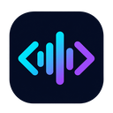

# BoloCode — Voice Coding Agent

<p align="center">
  
</p>

<p align="center">
  <strong>Control Visual Studio Code hands-free using your voice in Hindi, English, or Hinglish.</strong>
</p>

<p align="center">
  
  
  
</p>

---

## What is BoloCode?

**BoloCode** is a voice-first coding agent for Visual Studio Code. You speak — BoloCode acts. It is a **VS Code extension + Tauri desktop app** pair:

- The **desktop app** (Windows/macOS/Linux) captures your voice, transcribes it with Groq Whisper, routes it through an LLM, and sends tool commands back.
- This **VS Code extension** runs a local WebSocket server (`127.0.0.1`) that receives those commands and executes them inside your editor.

You don't need to install any cloud service or configure any server — it all runs on your machine.

---

## How to Connect the BoloCode App

1. **Install the BoloCode desktop app** from [GitHub Releases](https://github.com/abhishek4524/bolocode/releases).
2. **Install this extension** in VS Code:
   ```bash
   code --install-extension bolocode-extension-0.1.0.vsix
   ```
3. **Open a workspace folder** in VS Code (`File → Open Folder`).
4. The extension starts automatically on VS Code launch. Check the status bar at the bottom right:
   - `$(mic) BoloCode` — Connected and ready.
   - `$(debug-disconnect) BoloCode` — Disconnected.
5. Launch the **BoloCode desktop app**, configure your Groq API key in Settings, and start speaking!

---

## Status Bar States

| Icon | State | Meaning |
|------|-------|---------|
| `$(mic) BoloCode` | **Connected** | Extension is running, BoloCode app can connect |
| `$(debug-disconnect) BoloCode` | **Disconnected** | Server failed to start or was stopped |
| `$(sync~spin) BoloCode` | **Busy** | A voice command tool is executing |

Click the status bar item at any time to see the port number, workspace path, and process PID.

---

## Available Tools (12 Core Operations)

The extension exposes the following tools that the BoloCode agent can execute inside VS Code:

| Tool | Description |
|------|-------------|
| `create_folder` | Create a new folder in the workspace |
| `create_file` | Create a new file (with optional initial content) |
| `write_file` | Overwrite a file's complete content |
| `edit_file` | Search & replace text, or insert code at a specific line number |
| `read_file` | Read file content (optionally a line range) |
| `list_dir` | List files and folders in a directory |
| `delete_path` | Delete a file or folder (**dangerous — requires confirmation**) |
| `move_path` | Rename or move a file or folder |
| `open_file` | Open a file in the editor (optionally jump to a line) |
| `get_active_file` | Get info about the currently active editor tab |
| `search_in_files` | Full-text search across workspace files |
| `run_command` | Run a shell command in the integrated terminal |

### Example Voice Commands

```
"root me todo-app folder banao"           → create_folder("todo-app")
"index.html ki 15th line me naya code daalo" → edit_file(line: 15)
"script.js read karo"                     → read_file("script.js")
"npm install run karo"                    → run_command("npm install")
```

---

## Security Model

BoloCode is designed to be **secure-by-default**:

### 1. Localhost Only
The WebSocket server binds exclusively to `127.0.0.1` (loopback). No external network connections are accepted. All origin headers are validated.

### 2. Token Authentication
On every startup, the extension generates a **256-bit cryptographically secure random token** (`crypto.randomBytes(32)`). This token is written to `~/.bolocode/instances/<PID>.json` and must be presented in the first WebSocket handshake frame. All subsequent frames are accepted only from authenticated connections.

### 3. Workspace-Only Path Sandboxing (`PathGuard`)
Every file path parameter is resolved relative to the opened VS Code workspace root and validated to not escape it. Attempts to access `/etc/passwd`, `../../sensitive-file`, or absolute paths outside the workspace are rejected with an `OUT_OF_BOUNDS` error.

### 4. Dangerous Action Confirmation
High-risk operations require explicit **on-screen + spoken confirmation** before executing:
- `delete_path` (any file or folder deletion)
- `run_command` with destructive patterns (`rm -rf`, `git push --force`, `sudo`, `chmod`, `format`, `drop`)
- Any operation targeting paths outside the workspace root

---

## Commands

| Command | Description |
|---------|-------------|
| `BoloCode: Start Voice Agent Server` | Manually start the WebSocket server |
| `BoloCode: Stop Voice Agent Server` | Stop the WebSocket server |
| `BoloCode: Show Connection Info` | Show port, workspace, and PID in a notification |

---

## Troubleshooting

| Problem | Solution |
|---------|----------|
| Status bar shows `$(debug-disconnect) BoloCode` | Try running `BoloCode: Start Voice Agent Server` from the Command Palette. Ensure no firewall blocks localhost. |
| BoloCode app says "No active VS Code instances found" | Make sure a **folder is open** in VS Code (not just a file). The extension only registers when a workspace is open. |
| "Access Denied (OUT_OF_BOUNDS)" error | The agent is trying to access a path outside your workspace. Open the correct folder in VS Code. |
| Tool times out (90s) | The extension may have crashed. Reload VS Code (`Developer: Reload Window`) and try again. |
| Extension not activating | Check the VS Code output panel (`View → Output → BoloCode`) for error messages. |

---

## Extension Host Communication

```
BoloCode Desktop App (Tauri)
         │
         │  Local WebSocket (ws://127.0.0.1:<port>)
         │  JSON Protocol: auth_request → auth_response → tool_request → tool_response
         ▼
VS Code Extension (This Extension)
         │
         ├── PathGuard (workspace sandboxing)
         ├── SecurityClassifier (dangerous action detection)
         └── ToolDispatcher → FileOps / EditorOps / SearchOps / TerminalOps
```

---

## License

Apache License 2.0 — see [LICENSE](LICENSE) for full details.
